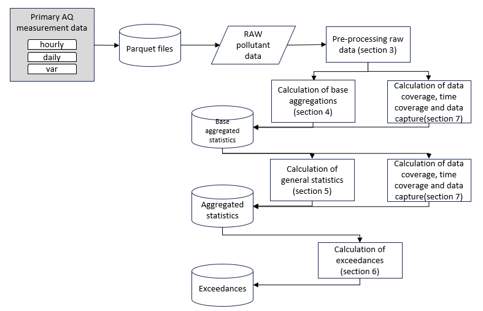

# 1 Introduction

This document defines the rules for calculation of aggregations and statistical values based on air quality observations as specified by the Directive 2024/2881 (EU, 2024). The document is intended as a technical specification for developers who will write the software routines for the European Environment Agency (EEA) and therefore no prior knowledge of air quality legislation or air quality reporting is assumed.

The aggregations and statistics presented form the evidence base required to assess compliance with the Directive and to demonstrate attainment of environment objectives. However, the scope of this document is limited to the calculation-based aggregations and statistics. It does not extend to the full logic and extensive rules for assessing the attainment of environment objectives; this will be addressed in a separate document.

<figure class="aura-figure" id="figure-1">

<figcaption><strong>Figure 1:</strong> Overview calculation-based values, statistics and exceedances</figcaption>
</figure>

Calculations are made on all primary (base) measurement data (observations) reported by the countries under the Air Quality e-Reporting system. The rules presented in this document are based on those in operation within the Air Quality e-Reporting system. Note that the aggregation rules are also applicable to modelled air quality data.

Numerical rounding principle: All calculations shall be rounded only once, as the last step, immediately before comparing the result with any threshold. This ensures consistency and prevents rounding errors from affecting compliance assessments.

Statistical parameters are initially calculated for all sampling points regardless of **data coverage** rates (the proportion of valid data available within a given period). The resulting aggregated data and statistics are stored in a database without applying the formal rounding procedures established for reporting, along with associated information on **time coverage** and **data coverage**. To meet end-user data needs and support for compliance assessment, the statistical parameters may be selected and downloaded from the aggregated database based on user defined data capture, time coverage and data coverage selections including thresholds specified by the Directive(s) data quality objectives (DQOs).

This document is structured as follows:

- Chapter 2 defines processing of raw data.

- Chapter 3 presents the pre-processing of data.

- Chapter 4 documents the calculation of base aggregations.

- Chapter 5 defines how general statistics are to be calculated.

- Chapter 6 shows the calculation of basic exceedance information

- Chapter 7 documents how the calculation of data capture, data coverage and time coverage rates are to be made.
