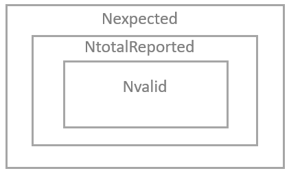

# 7 Data capture, time coverage and data coverage

<table>
<colgroup>
<col style="width: 100%" />
</colgroup>
<thead>
<tr class="header">
<th><blockquote>

<strong>KEY NOTE</strong>

<em>All statistics calculated from the primary data or from the base aggregations described in Chapter 5 shall be accompanied with information on data capture, time coverage and data coverage. These will be provided for all aggregations in order for users to select data appropriately for their needs. If aggregations are used for compliance purposes, the user needs to use those percentages required under the Directive (see Table 4).</em>

</blockquote></th>
</tr>
</thead>
<tbody>
</tbody>
</table>

## 7.1 Definitions

To automate the calculation across all pollutants, reported primary data and statistics, three statistics are needed to understand the aggregation results. These statistics are defined in this section.

### 7.1.1 Data capture (Dcap)

The data capture is the percentage of valid measurements over the total number of reported measurements over the averaging period.

For continuous measurement monitoring, EEA expects full delivery across all measuring period with appropriate validity flag. Please note that if full deliveries are not provided for continuous measurements (hourly/daily), the data capture calculated by EEA might differ from reporter’s calculations. If full data delivery is not provided, please use data coverage to obtain the % of valid measures over the averaging period.

### 7.1.2 Time coverage (TC)

The time coverage is the percentage of measurement time in each averaging period.

### 7.1.3 Data coverage (DC)

The data coverage is the percentage of valid measurements over the given averaging period. When assessing the appropriateness of any statistics, data coverage is the most appropriate statistic to understand the representativeness of a statistic over an averaging period.

## 7.2 Calculation algorithms

For all aggregations, the following is “counted” in the corresponding period of aggregation[^26]:

- *count_validdata*: number of measures with validity flag \> 0

- *count_notvalid_maint*: number of measures with validity flag -99

- *count_notvalid_other*: number of measures with validity flag -1

- *count_notvalid_null*: number of measures with validity flag 0 or missing

- *interval*: total number of measures

Note that where a measurement method delivers hourly values, these counts and interval shall be calculated using number of hours. Where a measurement method delivers daily values, the counts and interval shall be calculated using number of days.

Then, Dcap, DC and TC are calculated according to the following algorithms:

$$Dcap = \frac{count\_ validdata\ }{count\_ validdata + count\_ notvalid\_ maint\  + count\_ notvalid\_ other} \bullet 100\%$$

$$DataCoverage = \frac{count\_ validdata\ }{interval} \times 100\%$$

$$TC = \frac{count\_ validdata + count\_ notvalid\_ maint\  + count\_ notvalid\_ other\ }{interval} \bullet 100\%$$

i.e.:

$$DC = Dcap \times TC$$

### 7.2.1 Calculations for hourly and daily data types{ref}`[29] <footnote-29>`

The **data capture** for hourly and daily measurements is the percentage of valid measurement values in a given data set. The data capture in a given averaging period is defined as follows:

$$Dcap = \frac{N_{valid}}{N_{totalReported}} \bullet 100\ \%$$

The **data coverage** for hourly and daily measurements is the percentage of expected measurement (based on the official measurement schedule) that are present and valid in the dataset. It is defined as:

$$DataCoverage = \frac{N_{valid}}{N_{expected}} \bullet 100\ \%$$

The **time coverage** is the percentage of measurement time in a given averaging period.

$$TC = \frac{N_{totalReported}}{N_{expected}} \bullet 100\ \%$$

Where:

- Nvalid is the number of valid hourly/daily values (validity flag \> 0)

- NtotalReported is the number of hours/days reported in that measurement period.

- Nexpected number of expected measurement values, based on the nominal temporal resolution (e.g. 24 per day for hourly data, 365/366 per year for daily data)

Example 13

<blockquote>

Calculating annual mean from NO2 primary hourly values.

Nvalid: 7724 h

Ntotalreported: 8760 hours (full dataset)

Nexpected: 8760 hours

</blockquote>
<table>
<colgroup>
<col style="width: 30%"/>
<col style="width: 34%"/>
<col style="width: 34%"/>
</colgroup>
<thead>
<tr class="header">
<th>TimeCoverage</th>
<th>DataCapture</th>
<th>DataCoverage</th>
</tr>
</thead>
<tbody>
<tr class="odd">
<td>$$\frac{8760}{8760} \bullet 100 = 100\ \%$$</td>
<td>$$\frac{7724}{8760} \bullet 100 = 88,17\ \%$$</td>
<td>$$\frac{7724}{8760} \bullet 100 = 88,17\ \%$$</td>
</tr>
</tbody>
</table>$$\frac{8760}{8760} \bullet 100 = 100\ \%$$$$\frac{7724}{8760} \bullet 100 = 88,17\ \%$$$$\frac{7724}{8760} \bullet 100 = 88,17\ \%$$

Example 14

<blockquote>

Calculating annual mean from PM10 primary daily values.

Nvalid: 309 days

Ntotalreported: 362 days (missing 3 days for averaging period)

Nexpected: 365 days

</blockquote>
<table>
<colgroup>
<col style="width: 33%"/>
<col style="width: 33%"/>
<col style="width: 33%"/>
</colgroup>
<thead>
<tr class="header">
<th>TimeCoverage</th>
<th>DataCapture</th>
<th>DataCoverage</th>
</tr>
</thead>
<tbody>
<tr class="odd">
<td>$$\frac{362}{365} \bullet 100 = 99,18\ \%$$</td>
<td>$$\frac{309}{362} \bullet 100 = 85,36\ \%$$</td>
<td>$$\frac{309}{365} \bullet 100 = 84,66\ \%$$</td>
</tr>
</tbody>
</table>$$\frac{362}{365} \bullet 100 = 99,18\ \%$$$$\frac{309}{362} \bullet 100 = 85,36\ \%$$$$\frac{309}{365} \bullet 100 = 84,66\ \%$$

### 7.2.2 ### Calculations from base aggregation data

The calculations for base aggregation data are done following same logic as shown in Chapter 7.2.1

<table>
<colgroup>
<col style="width: 100%" />
</colgroup>
<thead>
<tr class="header">
<th>
KEY NOTE

<em>In this case, it must be clearly stated that data coverage, data capture, and time coverage depend not on the original data type (hourly or daily), but on the <strong>base aggregation level</strong> employed.</em>

<ul>
<li>
<em>For instance, when calculating an indicator such as <strong>P1Y-daysAbove25</strong> (Number of days with daily average values higher than 25 [unit] in a given year), and the original data are hourly, the base aggregation to be considered is <strong>P1D</strong>, because the objective is to count the number of days.</em>
</li>
<li>
<em>Similarly, if the indicator is <strong>P1Y-dmax-per93.15</strong> (e.g. O₃, 26th highest P8H-dmax value), the reference for completeness is not the number of hourly measurements reported, but the number of <strong>P8H-dmax</strong> values calculated.</em>
</li>
</ul>

<em>Therefore, completeness metrics (data coverage, data capture, time coverage) must always be assessed based on the temporal resolution of the <strong>base aggregation</strong> required by the specific indicator, regardless of the original input frequency.</em>
</th>
</tr>
</thead>
<tbody>
</tbody>
</table>

### 7.2.3 Missing data fractions arising from maintenance and calibration

The percentage of values missing due to station maintenance or calibration in a given averaging period is calculated as follows:

$$Perc_{main\_ cal} = \frac{N_{main\_ cal}}{N_{expected}} \times 100\%$$

where *Nmain_cal* is the number of invalid hourly or daily values with a validity flag = -99 (Not valid due to station maintenance or calibration) and *Nexpected *is the number of hours/days in the averaging period.
